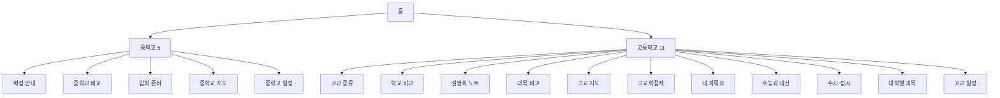
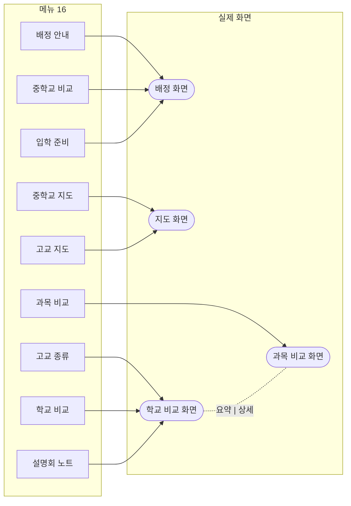
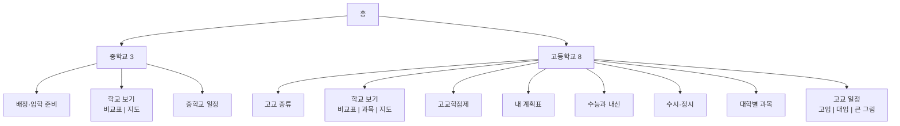
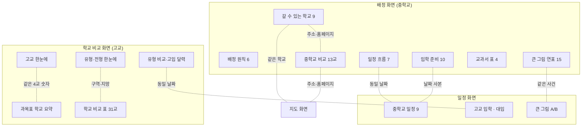
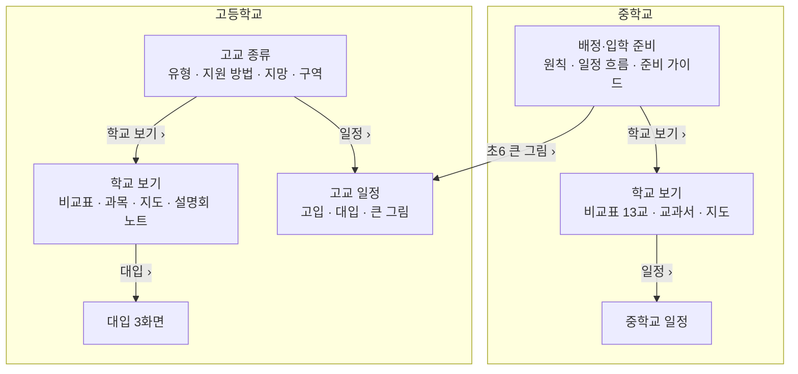
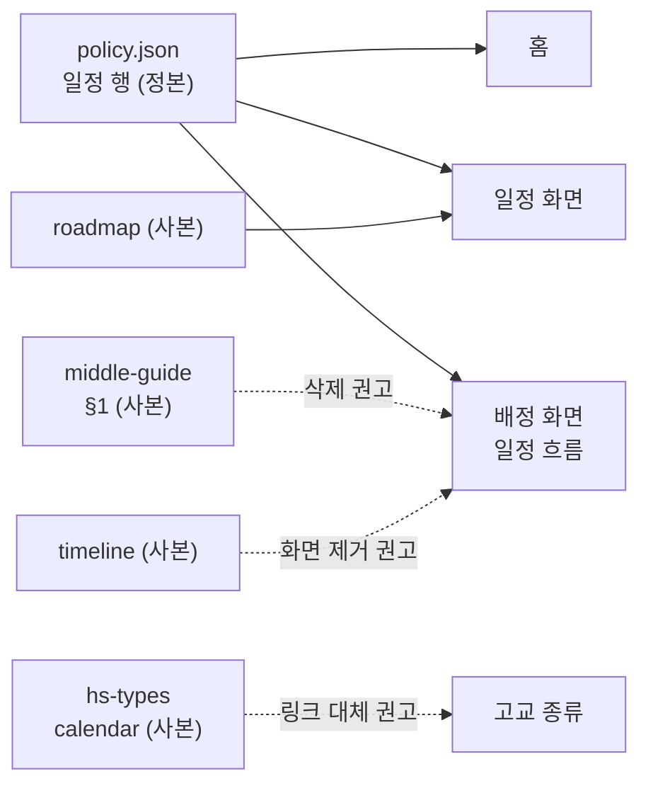

# 콘텐츠 맵 · 중복 지도 · 통합 제안 (정보구조 독립 감사)

- 기준: `origin/main` 79ec815(PR #553), 만든 세션이 아닌 독립 감사. 워크트리 `/tmp/cmap`에서 `python3 -m http.server` + Playwright(1440·390)로 실제 화면을 열고, 접이식(`details`)을 모두 펴서 제목·본문을 읽었다. 데이터 값은 `portal/data/*.json`을 직접 열어 대조했다.
- 표기: **[확인]** 화면·코드·데이터로 직접 확인, **[판단]** 감사자 추정.
- 제약 준수: 사람 이름 없음, 새 기능 없음(구조·합치기만), 화면의 출처·확인일·상태 칩 삭제 결정 유지(자료실만), 최상위 중학교/고등학교 2그룹·2단계 유지, 항목 수는 줄이는 쪽. 커밋하지 않았다.
- 앞선 검수 `evaluation/ia-review.md`(2026-11-06)는 "메뉴 이름·단계"를 다뤘다. 이 문서는 그 뒤 반영된 구조(2026-11-08 중·고 2그룹)를 기준으로 "같은 정보가 어디에 몇 번 있나"를 다룬다.

---

## 0. 결론 (먼저)

1. **학교 개요(비교)와 지도는 한 페이지에 들어가는 게 맞다.** 근거 4가지.
   - 지도 화면(`map.js`)은 이미 학교급 칩(전체·초·중·고)과 목록 보기를 갖고 있고, "중학교 지도"와 "고교 지도"는 **같은 화면의 기본 칩만 다른 메뉴 두 개**다 [확인].
   - 학교 정보(주소·홈페이지)가 비교표·지도 목록·배정 화면 표 3곳에 따로 그려진다. 중학교 홈페이지는 같은 학교인데 세 곳이 서로 다르게 보인다(§3 D1).
   - 학교 비교 화면에는 이미 "요약 | 상세(과목 비교)" 토글이 있어 "한 페이지 안 보기 전환" 방식이 화면 안에 익숙하다 [확인].
   - 휴대폰에서 학교 이야기가 지도·비교·과목 3화면으로 흩어져 있다.
2. **메뉴 항목 16개(중 5·고 11)가 실제로는 12종 화면**이다. 같은 화면에 항목 3개가 겹쳐 있다 [확인].
   - 중학교: `배정 안내` · `중학교 비교` · `입학 준비` = 한 화면(`v=middle`), 주소 뒤 `open=`만 다르다.
   - 고등학교: `고교 종류` · `학교 비교` · `설명회 노트` = 한 화면(`v=hs`), `ty=1`·`bf=`만 다르다. 이 화면이 가장 길다(390px에서 접은 채 5.3화면, `ty=1`로 열면 8.3화면, 설명회 노트 주소는 10.8화면).
3. **제안: 메뉴를 16 → 11개로 줄인다**(중 5→3, 고 11→8). 중학교는 `배정·입학 준비` / `학교 보기`(표|지도) / `중학교 일정`, 고등학교는 `고교 종류` / `학교 보기`(비교표|과목|지도) 등. 화면 종류는 12 → 11종이 되고, 메뉴 항목과 화면이 1:1이 된다.
4. **같은 날짜·값이 손으로 옮긴 사본으로 3~7곳에 있다**(중학교 배정 날짜 7곳, 경기 후기 고입 날짜 4묶음(7군데), 수능 날짜 6곳). 지금은 값이 서로 맞지만(대조함) 어느 한 곳만 고쳐지면 어긋난다. 정본 1곳과 "파생 또는 링크"로 줄이는 안을 §3에 적었다.
5. **지금 이미 어긋난 곳(불일치·결함)도 확인했다**(§3-B): 같은 `2030학년도 수능` 행이 2줄 표시, 중학교 홈페이지 3곳 표시 불일치, 고교 지망 수 10 vs 11, 교복 가격 기준 연도 2종 등.

---

## 1. 현재 구조 사실 (확인한 것)

| 항목 | 값 | 근거 |
|---|---|---|
| 메뉴 항목(좌측 트리) | 중학교 5 · 고등학교 11 · 자료·소식 5(맨 아래 작은 글자) + 홈 | `portal/menu-tree.js` |
| 하단 바(<900px) | 메뉴 · 오늘 · 일정 · 검색 | `BOTTOM` |
| 실제로 다른 화면 | 중 3종(배정 / 지도 / 일정) + 고 9종(학교 비교 / 과목 비교 / 지도 / 학점제 / 계획표 / 수능·내신 / 수시·정시 / 대학별 과목 / 일정) = **12종** | 화면별 DOM 덤프 |
| 같은 화면에 겹친 메뉴 | 배정 안내·중학교 비교·입학 준비 / 고교 종류·학교 비교·설명회 노트 / 중학교 지도·고교 지도(같은 컴포넌트) | `app.js` 205~208행, `middle.js` 126행, `map.js` |
| 일정 화면 | 메뉴 2개(중학교 일정, 고교 일정)가 **한 화면의 4탭**(고교 입학·대학 입시·졸업·입학·학년별 큰 그림)을 나눠 가짐 | `policy.js` 190~210행 |
| 하단 바 `일정`(`#schedule`) | 코드 주석은 "중·고 전체 일정"이지만 실제는 **고교 입학 탭**(고교 일정과 같은 2,898자) | 덤프 `schedule` = `schedule?t=hs` |
| 홈 | 좌=고등학교, 우=중학교 2분할. 각 열: 곧 있을 일(졸업·입학 D-day 카드 + 일정 2건 + 수능 D-day) / 일정(접이식) / 소개(메뉴 링크 4개) | `home.js` |
| 데이터 로딩 | 어느 화면이든 22개 JSON을 한꺼번에 가져온다(화면별 사용처는 코드 읽기로 구분) | 네트워크 로그 |

390px 접은 상태 높이(첫 로드 후 맨 아래까지 스크롤한 문서 높이 / 화면 844px 기준): 홈 2.3 · 배정 안내 3.7 · 중학교 지도 2.1 · **고교 종류 8.3 · 학교 비교 5.3 · 설명회 노트 10.8** · 과목 비교 1.8 · 고교 지도 3.8 · 고교 일정 4.4 · 중학교 일정 4.0 · 수능과 내신 2.7 · 수시·정시 3.5 · 학점제 3.0 · 대학별 과목 2.9 · 계획표 2.6.

---

## 2. 콘텐츠 맵 (화면 인벤토리)

범례: 주소 변형 = 쿼리(v, t, ty, open, bf, lv, p, s, c, m, g, hl …). "접이식" = 열어야 보이는 블록. 데이터는 `portal/data/` 파일(행 id).

### 2-1. 홈 `#home`

| 블록 | 핵심 내용 | 데이터 | 비고 |
|---|---|---|---|
| 열 머리(좌 고등학교 / 우 중학교) | `2030학년도 대입` / `2033학년도 대입` | `learners.json`(A·B) | 이름·프로필 없음 |
| 곧 있을 일 | 졸업(중3: 2026.12.18, 초6: 12.31) D-day 카드(사진은 브라우저에만 저장), 곧 올 일정 2건, 좌측만 수능 D-day | `policy.json` topic `hs-schedule`·`gg-hs-entry`·`exam-schedule`·`life-schedule`, `learners.json` csat | 일정은 정책 행의 파생 |
| 일정(접이식, 열림) | 다음 일정 최대 6건, `전체 일정 ›` | 위와 같음 | 좌 → `schedule?t=hs`, 우 → `schedule?t=life` |
| 소개(접이식, 모바일은 닫힘) | 좌: 고교 종류·학교 비교·과목 비교·고교학점제 / 우: 배정 안내·중학교 비교·입학 준비·중학교 지도 | `menu-tree.js` desc | 메뉴를 다시 나열 |
| (코드에만 있음) | `dash.js`의 `planPanel`·`admPanel`·`midPanel`·`hubsHtml`은 어디서도 안 쓰임 | - | 죽은 코드 [확인] |

### 2-2. 중학교

| 화면(주소) | 메뉴 | 블록(위→아래) | 데이터 | 접이식 |
|---|---|---|---|---|
| **배정 화면** `?v=middle` (+`open=cmp`·`open=guide`) | 배정 안내 / 중학교 비교 / 입학 준비 | ① 초등학교 고르기(검색+선택, 근거리표 외부 링크) ② 미정 한 줄 ③ **1 배정 원칙** 6개(소속 학군, 지원 방식, 배정 방법, 근거리 5교 미확인, 이사·전입·배정 후 변경, 2030 시점 제도) ④ **2 배정 일정 흐름** 7줄 ⑤ **중학교 비교** 13교 표 ⑥ **입학 준비 가이드** 4구역 10항목(배정부터 등록까지·교복·교과서·예비소집) ⑦ **큰 그림 연표** 초6→대입 15건 ⑧ **3 갈 수 있는 학교** 9교 표(주소·지도·홈페이지) ⑨ 4 지도로 한꺼번에 보기 링크 ⑩ 학교별 교과서 표 4교 | ③ `middle.json`(principles mp-01~06, areas zoneSchools), ④ `policy.json` life-03~09, ⑤ `middle-compare.json`(14항목) + `places.json`, ⑥ `middle-guide.json`, ⑦ `timeline.json`(tl-01~15), ⑧ `places.json`, ⑩ `middle-curriculum.json` | ③ 일부, ⑤⑥⑦⑩ 모두 접이식 |
| 중학교 지도 `?v=map&lv=middle` (+`p=`) | 중학교 지도 | 보기(지도/목록) · 학교급 칩(전체·초·중·고) · 주변 시설 · 지도 · 선택 학교 상세(주소·홈페이지·네이버/카카오 링크) · 목록 | `places.json`(69곳: 초 25·중 13·고 31, nearby 5) | 없음 |
| 중학교 일정 `?t=life` (= `schedule?t=life`) | 중학교 일정 | 탭줄 4개(고교 입학·대학 입시·졸업·입학·학년별) + 대상 칩 3 + 단계 칩 4 + 일정 표 9건(+지난 1건) + **일정 미확인** 2행(배정 원칙 요약, 중학구 고시 확정) + 캘린더 구독 | `policy.json` life-01~12 | 지난 일정 |

### 2-3. 고등학교

| 화면(주소) | 메뉴 | 블록(위→아래) | 데이터 | 접이식 |
|---|---|---|---|---|
| **학교 비교 화면** `?v=hs` (= `v=summary`; `ty=1`, `bf=` 변형) | 고교 종류 / 학교 비교 / 설명회 노트 | ① `요약 | 상세` 토글(상세=과목 비교) ② 학교 칩(풍덕·성복·수지·홍천) ③ **고교 유형·전형 한눈에**(접이식): 고교 유형 4 · 경기 고입 안내 15 · 추첨 배정(2026 조사표) 7 · 경기 배정 변경 1 · 서울 참고 1 · 고교학점제 입학 후 제도 1 · 선택 기준(학원 의견) 6 ④ **고교 한눈에**(필수·선택 학점, 후보 과목, 선택 폭 막대) ⑤ **과목표 학교 요약** 4교 카드(학기별 학점·창체·메모) + 홍천고 설명회 노트 ⑥ **학교 31곳 기본 정보 표**(접이식): 학교 비교 5교 × 22항목 + 선택과목 현황 + 내신 시험(1·2·3학년 평가계획) ⑦ **고교 유형 비교 5종** · 경기 고입 달력 12 · 원서 절차 5단계 · 준비 서류 3 | ③ `policy.json`(hs-07~10, gg-05~13(gg-08 제외)·17~23, asg-01~07, gg-24, hs-15, cur-01, hs-choice-opinion 5·acd-04), ④⑤ `summary.json`·`curricula.json`·`school-notes.json`·`briefings.json`, ⑥ `hs-compare.json`·`electives.json`·`exam-trends.json`, ⑦ `hs-types.json`(types 5·calendar 12·procedure 5·documents 3) | ③⑥ 접이식, ⑦ 스크롤 가까이 오면 그림 |
| 과목 비교 `?v=compare` (+`s`,`a`,`f`) | 과목 비교 | `요약 | 상세` 토글 · 학교 칩 · 필터(영역 7, 이수 방식, 구분, 학년·학기, 수능 범위 추정, 택n 묶음) · 학교별 개설 과목 표(열=학교, 행=과목) | `offerings.json`·`subjects.json`·`subject-matrix.json`·`facets.json` | 필터 일부 |
| 고교 지도 `?v=map` | 고교 지도 | 중학교 지도와 **같은 컴포넌트**, 학교급 칩 기본값만 고등학교 | `places.json` | 없음 |
| 고교학점제 `#life/credit` | 고교학점제 | 졸업 학점 구성 · 학년별 여정(4교) · 과목 이수 요건 · 공통과목 필수학점 · 과목 유형 · 성적 산출 · 과목 선택 절차 · 대학 권장이수과목과 학교 교육과정 · 우리 4개교(과목표 전체) | `policy.json`(cur-*, hs-11~14, log-16), `summary.json` | 18개 |
| 내 계획표 `#planner/plan` | 내 계획표 | 학기별 6칸 · 학점 합계(138/192 등) · 필수 이수 · 대학 요건 | `planner-rules.json` + 브라우저 저장 | 6개 |
| 수능과 내신 `#admission/system` | 수능과 내신 | ① 한 줄 안내(2027.3 공표 전까지 확정 아님) ② **수능·내신 규칙**(통합형 수능, 내신 5등급 상대평가) ③ **2028학년도 개편안과 2030학년도 적용** 10 ④ **2030학년도 대상 추가 동향** 3 ⑤ **대입 전형 구조** 18 ⑥ 수능 출제범위(참고) ⑦ 학원 설명 자료 3 ⑧ 공식 이미지 | ② `rules.json`, ③④⑤⑥⑦ `policy.json`(adm-01~13, str-01~18, cur-*, acd-*), ⑧ `image-credits.json` | 8개 안팎 |
| 수시·정시 `#admission/system?t=types` | 수시·정시 | 탭줄(제도 | 전형 한눈에) · **전형 한눈에**(전형 5열: 교과·학종·논술·수능최저·정시) · **전형별 비중**(str-16·17·18 3행) | `admission-types.json`, `policy.json` | 3개 |
| 대학별 과목 `?v=univ` (+`u`,`us`) | 대학별 과목 | 대학 12곳 선택 · 모집단위 · 학교 과목표와 맞춰 보기 | `universities.json`·`admission-rules.json`(78)·`matches.json`·`subject-master.json` | 1개 |
| 고교 일정 `?t=hs` (+`univ`, `road`) | 고교 일정 | **고교 입학 탭**: 경기 고입(전기 9줄·후기·외국어고·평준화 + 설명회) + 서울 토글 4 / **대학 입시 탭**: 수능·수시·정시·대교협 일정 9줄 / **큰 그림 탭**: 기준 학년(중3|초6) · 학생/학부모 · 단계 · 학년별 시기표 / + 캘린더 구독 + **곧 열려요**(대학·학과 찾기, 학교별 시뮬레이션, 목표 학과 체크) | `policy.json` events, `roadmap.json`(A 15·B 17), `schedule.ics` | 지난 일정 |

### 2-4. 자료·소식(맨 아래 작은 글자) · 하단 바

| 화면 | 블록 | 데이터 |
|---|---|---|
| 바뀐 소식 `#changelog` | 감시 봇 감지 5 + 제도 변경 로그 | `policy.json` change-log, `research/data/watch-state.json`. 옛 `admission/system?t=log`는 여기로 이동(확인) |
| 관련 사이트 `#library` | 외부 링크 22건 8분류, 홈 화면 추가법 | `links.json` |
| 출처·확인일 `#library/sources`(+`library/status` 별칭) | 출처별 "이 출처를 쓰는 제도·일정 N건" | `sources.json` |
| 원본 파일 `#library/files` | 학교에서 받은 사진·양식 | `files.json` |
| 화면 설정 `#library/settings` | 화면 모드·스킨 | 브라우저 저장 |
| 하단 바 | 메뉴(서랍=같은 트리) · 오늘(홈) · 일정(`#schedule`) · 검색 | `BOTTOM` |

### 2-5. 쿼리 변수 사전(통합 시 보존 대상)

| 변수 | 쓰는 화면 | 뜻 |
|---|---|---|
| `v` | 학교 계열 전부 | `hs`(`summary`) / `middle` / `map` / `compare` / `univ` |
| `ty` | `v=hs` | `1` = 고교 유형 패널 열기. **수시·정시 표 선택 키도 `ty`** (다른 화면, 이름 충돌 주의) |
| `bf` | `v=hs` | 설명회 노트 위치(`1` 또는 학교 id) |
| `lv` | `v=map` | `middle` |
| `open` | `v=middle`, `#home` | `cmp` / `guide`, 홈은 블록 클래스 |
| `p` | `v=map` | 강조할 장소 id |
| `s`·`a`·`f` | `v=hs`·`compare` | 학교 id 목록 / 영역 / 상세 필터 |
| `c`·`m` | 표 선택 | 고교 비교(`c`)·중학교 비교(`m`) 선택 학교 |
| `g`·`in`·`col`·`hl` | 비교표·검색 | 열 그룹 / 표 행만 / 강조 열 / 검색 강조(텍스트 일치로 접이식을 열어 찾음) |
| `t`·`st`·`wk`·`seoul`·`b`·`w` | 일정·큰 그림 | 탭 / 단계 / 이번 주 / 서울 / 기준 학년 / 학생·학부모 |
| `u`·`us` | `v=univ` | 대학·모집단위 |

`hl`은 **텍스트로 찾아 접이식을 연다**(`hl.js`). 그래서 도착 화면에 같은 글이 있으면 화면을 합쳐도 검색 deep link가 살아 있다. 단, 글이 **더 이상 그 화면에 없으면** 찾지 못한다(§5-4, 5-6).

---

## 3. 중복·겹침 지도

겹치는 정도: **동일**(같은 값·같은 문장) / **부분**(일부 겹침) / **표현**(같은 사실·다른 표현). 위험: ▲ 지금 이미 어긋남, △ 사본이라 앞으로 어긋날 수 있음, ○ 파생(같은 행을 다시 그림)이라 어긋나지 않음.

### 3-A. 중복 목록

#### 학교 정보

| # | 정보 | 위치들 | 정도 | 정본 | 권고 | 위험 |
|---|---|---|---|---|---|---|
| D1 | **중학교 학교 정보**(주소·홈페이지·학교군) | ① 배정 화면 "3 갈 수 있는 학교" 표(주소·지도·홈페이지) ② 중학교 비교 13교 표(주소·학교군·홈페이지·전화) ③ 중학교 지도 목록·상세 | 부분. 주소 13/13 일치 | `places.json`(이름·주소·좌표) + `middle-compare.json`(학교군·홈페이지·전화) | ①을 **삭제**하고 ②의 기본 선택(= 내 초등학교에서 갈 수 있는 9교)으로 대체. ②의 학교 줄에 `지도`(→ 지도 보기) 링크 유지 | ▲ **홈페이지가 같은 학교인데 3곳이 다름**: 지도 상세는 링크 없음(`places.json` 중학교 13곳 홈페이지가 비어 있음), 배정 표는 "홈페이지 찾기"(네이버 검색), 비교표는 실제 주소(13/13 있음). 고등학교는 31/31 일치 |
| D2 | **고교 학교 정보**(유형·구역·입학 방식) | ① 학교 비교 5교 표 ② 고교 한눈에 ③ 과목표 학교 요약 카드 ④ 고교 종류 "용인학군 구역 구성" ⑤ 고교 지도 상세 | 부분 | `hs-compare.json`(학교별), 구역 규칙은 고교 종류 | 학교 보기(비교표) 한 곳에서 ①②③을 이어서 보이게 정리. ④는 규칙으로 고교 종류에만 둠 | ▲ `hs-compare` 안에서 `type` 표기가 "일반고등학교"(수지구 10교)·"일반고"(나머지)로 섞이고, 입학 방식 문구도 수지구 4교와 6교가 다르다. 백암고·용인외대부고는 입학 방식·구역이 비어 있다(`hs-types`와 고교 종류에는 설명 있음) |
| D3 | **4개교 학점·과목 수 숫자** | ① 고교 한눈에 막대(필수 120·선택 54·후보 56·폭 3.11 등) ② 과목표 학교 요약 카드 ③ 학교 비교 표 `교육과정`·`개설 후보 과목 수` 행 ④ 고교학점제 "학년별 여정" ⑤ 과목 비교 ⑥ 계획표 | 부분(같은 `summary.json` 파생). 풍덕 56과목·필수 38과목 등 일치 확인 | `summary.json`/`curricula.json` | 비교표 탭에서 ①③을 위아래로 이어 붙이고(같은 4교 표 두 개), ②는 "학교별 자세히"로. ④⑥은 목적이 달라 유지 | ○ |
| D4 | **고교 유형 설명** | ① 고교 유형 4(`hs-07~10`) ② 고교 유형 비교 5종(`hs-types.json`) ③ 선택 기준(학원 의견 6) ④ 홈 소개 줄 | 부분 | 유형 비교 = `hs-types.json`, 고유 설명(일반고 전환·모집 현황)만 ① | 고교 종류 화면 안에서 ①②를 한 블록으로(②를 위, ① 고유 항목은 그 아래 보충). 학원 의견은 구분 표시 유지 | △ |
| D5 | **평준화 배정 방식·구역·지망** | ① 경기 고입 안내 2027 15(gg-06·07·10·11·12 …) ② 추첨 배정 2026 조사표 7(asg-01~07) ③ 유형 비교의 일반고 칸·원서 절차 4단계 ④ 학교 비교 `구역` 행 ⑤ 서울 참고 | 부분 + 해 다름(2027 공식 vs 2026 조사표) | 2027 공식(gg-*) | 2026 조사표(asg-*)는 "구역 구성·2구역 학교"만 남기고 지망·방식 설명은 gg로 일원화 | ▲ **지망 수**: asg-05가 "구역내 11지망(2구역 10칸 + 외·국·자 칸)", gg-11·`procedure` step 4는 "2구역 10지망". 같은 화면에서 숫자가 둘 |
| D6 | **경기 후기 고입 날짜** | ① 정책 events gg-02·03·04·15·16(일정 화면·홈) ② `hs-types.json` calendar 12 + types[].timing + procedure step 3·5(고교 종류 화면) ③ roadmap rm-a-02~05(큰 그림) ④ gg-* 카드 본문 | 동일(12.4~12.10, 외·국·자 12.11~24·발표 12.29, 평준화 배정 발표 1.6·1.22, 등록 1.25~27, 추가 2.4 모두 일치 확인) | `policy.json` events | ②의 calendar·timing 문장은 **일정 화면 링크**로 대체하거나 정책 행에서 파생. ③은 roadmap `refs`(정책 id)로 연결돼 있지만 날짜 문구는 손 사본 | △ 위험 높음(고칠 때 4묶음을 같이 봐야 함) |
| D7 | **설명회** | ① gg-08(이벤트: 10.19~11.27, 일정 화면) ② gg-20·gg-22(카드: 교원 9.30~10.16, 학생·학부모 10.19~11.27, 외·국·자 학교별 날짜) ③ 설명회 노트(홍천고 1건) ④ 메뉴 설명 줄 "일정은 일정 화면" | 부분 | 날짜=`policy.json` events | 설명회 노트는 별도 메뉴 항목이 아니라 학교 보기 안 "학교별 자세히"의 한 줄로(§4). gg-20의 날짜 문장은 일정 링크 | △ |
| D8 | **고교학점제 요약** | ① 고교 종류 화면 "고교학점제 입학 후 제도"(cur-01) ② 고교학점제 화면 ③ 큰 연표 tl-09·roadmap rm-a-10 ④ 수능과 내신 "선택과목 조사 → 고교학점제에서 자세히" ⑤ 계획표 합계 | 부분 | 고교학점제 화면(`cur-*`, `hs-11~14`) | ①을 **삭제**하고 "고교학점제 ›" 링크 한 줄로 | △ |

#### 중학교 배정·입학

| # | 정보 | 위치들 | 정도 | 정본 | 권고 | 위험 |
|---|---|---|---|---|---|---|
| D9 | **중학교 배정 날짜**(배정원서 11.2~13·추가배정 12.7~16·발표 12.31·등록 1.4~7·재배정 1.11~22) | ① 정책 life-03~08(**원본**: 중학교 일정, 홈) ② 배정 화면 "2 배정 일정 흐름"(같은 행을 다시 그림) ③ `middle-guide.json` §1 "배정부터 등록까지" 6줄(손 사본) ④ `middle.json` mp-06 본문 안의 날짜 ⑤ `timeline.json` tl-01·02 ⑥ `roadmap.json` rm-b-09~11 ⑦ `learners.json` 졸업일(2026-12-18) = life-01 | 동일(값 일치 확인) | `policy.json` events | ②는 유지(파생, ○). ③은 **삭제**(②와 겹침), ④는 문장에서 날짜를 빼고 "일정 흐름 참고"로, ⑤⑥은 D12 | △ 7곳 |
| D10 | **배정 원칙** | ① 배정 화면 원칙 6(`middle.json`) ② 중학교 일정 "일정 미확인" 2행(life-11 원칙 요약, life-12 중학구 고시 확정) | 부분 | `middle.json`(+life-12 고시 확정 내용) | 날짜 없는 행이 일정 화면에 들어간 것 자체가 구조 오류. 일정 화면에서 빼고 배정 화면 "미정" 줄·원칙에 합침(데이터상 topic 분리 필요) | △ |
| D11 | **교복·교과서·준비물** | ① 입학 준비 가이드(교복 낙찰금액 수지중 413,300원·손곡중 425,000원, 교과서 안내) ② 중학교 비교 `교복` 행(2026 학교알리미 기준, 수지중 정장 222,000+생활 188,000) ③ 학교별 교과서 표 4교 | 표현(기준 연도 다름) | 학교별 값 = 비교표, 신입생 낙찰·공지 = 가이드 | 학교 보기에서 교복 행 옆에 "2027 신입생 낙찰은 입학 준비 ›" 링크, 가이드는 낙찰·공지 전용. 교과서 표는 학교 보기의 학교별 자세히로 이동(§4) | ▲ 같은 학교의 교복 금액이 두 화면에서 다른 기준으로 나온다(문장으로 설명돼 있으나 두 곳에서 따로 읽힘) |
| D12 | **큰 그림 연표** | ① 배정 화면 "큰 그림 연표(초6→대입) 15건"(`timeline.json`) ② 일정 > 학년별 큰 그림(`roadmap.json`: A 15·B 17, 기준 학년 토글) ③ 정책 b33-01~09(2033 학년도 행) ④ "학년별 할 일" 곧 열려요 문구·RELATED 이름 | 부분(같은 사건·다른 문장) | `roadmap.json` | ①을 **화면에서 제거**하고 `일정 › 큰 그림(초6 기준)` 링크(`schedule?t=road&b=B`)로. `timeline.json`은 보관(데이터 삭제는 별건) | ▲ 2033학년도 수능: tl-14는 "11월 셋째 주 목요일 관행 2032.11.18", rm-b-07은 "11.18(11.11 가능성)". 같은 날짜인데 단서가 다름 |

#### 일정

| # | 정보 | 위치들 | 정도 | 정본 | 권고 | 위험 |
|---|---|---|---|---|---|---|
| D13 | **일정 화면 구조** | ① 중학교 일정 화면에 `고교 입학·대학 입시·학년별` 탭줄과 일반고·과학·영재·자사 칩이 그대로 보임 ② 하단 바 `일정`은 고교 입학 탭 ③ 홈 `전체 일정 ›`(열마다 다른 탭) ④ 졸업·입학 탭(life) = 중학교 일정 메뉴 | 구조 | 일정 화면 하나 | **중학교 일정**: 탭줄·대상 칩 숨김(life 전용). **고교 일정**: 탭 3개(고입 · 대입 · 큰 그림), `졸업·입학` 탭 삭제. 하단 `일정`은 "중학교 | 고등학교" 두 갈래 토글로 시작 | - |
| D14 | **같은 일정 행이 두 번** | ① `2030학년도 수능 시행일`(sch-07)과 `2030학년도 수능`(sch-12)이 같은 날(2029.11.15)·같은 문구로 대학 입시 탭에 2줄 ② `2027학년도 고교 입학(개학)`(sch-09, 대학 입시 탭)과 `고교 입학식·개학`(life-10, 졸업·입학 탭) | 동일 | sch-12(`learners.json` csat이 가리킴), life-10 | sch-07·sch-09를 삭제(또는 병합). 중학교 일정 화면에도 "고교 입학식"이 들어 있다 | ▲ 현재 화면에서 중복 표시. sch-09는 "3.2(화) 전후", life-10은 "3.2~3.3 전후"로 문구도 다름 |
| D15 | **홈 일정 vs 일정 화면** | 홈 두 열의 곧 있을 일·일정 = 정책 행을 같은 규칙으로 다시 그림 | 파생 | `policy.json` | 유지(홈은 창). "전체 일정 ›"은 유지 | ○ |
| D16 | **수능 날짜** | `learners.json` csat · sch-07 · sch-12 · rm-a-13 · `events.json`(4건) · `search-extra.js` 안내 문구 | 동일 | `learners.json` csat → sch-12 | D14와 함께 정리. 검색 문구는 날짜를 직접 쓰지 않고 홈 링크만 | △ |

#### 대입

| # | 정보 | 위치들 | 정도 | 정본 | 권고 | 위험 |
|---|---|---|---|---|---|---|
| D17 | **수능·내신 제도** | 같은 화면 안에서 3번: ① 수능·내신 규칙(`rules.json`: 통합형 수능, 내신 5등급) ② 2028학년도 개편안(adm-02 통합형 수능, adm-04 내신 5등급) ③ 학원 설명 자료(통합 수능·5등급, acd) | 부분(같은 사실) | ①(체제 표) + ②(공식 보도) | ①을 맨 위 "한눈에"로, ② 중 ①과 같은 항목(통합형 수능·5등급)은 접어서 근거로만 두기. ③은 학원 의견 구분 유지 | △ |
| D18 | **전형 구조·모집 비중** | ① 수능과 내신 > 대입 전형 구조 18행 ② 수시·정시 화면 "전형별 비중"(**str-16·17·18과 동일한 3행**) ③ str-04(2028 모집 규모)가 str-16에 포함 ④ 학원 자료(교과 45.4%) vs 대교협(45.3%) ⑤ 대학별 수능최저(str-06)와 `admission-rules.json` | 동일(②) / 부분 | 수시·정시 화면 | 전형 구조 18행을 **수시·정시 화면으로 이동**하고 수능과 내신은 "제도"만. ②의 3행 중복 삭제, ③은 str-16에 흡수 | ▲ 45.4% vs 45.3%(학원 합산 방식 vs 대교협 공식, 표기만 구분돼 있음) |
| D19 | **대학 권장이수과목** | ① 고교학점제 "대학 권장이수과목과 학교 교육과정"(cur-06·07) ② 대학별 과목 ③ 수능과 내신의 `선택과목 조사·대학 권장이수과목` 한 줄(cur-06·07 본문 재출력) | 부분 | 대학별 과목(`admission-rules.json`·`matches.json`) | ①③은 개념 설명만 남기고 "대학별 과목 ›" 링크 | △ |

#### 공통 구조

| # | 정보 | 위치들 | 정도 | 권고 |
|---|---|---|---|---|
| D20 | **곧 열려요**(대학·학과 찾기 / 학교별 시뮬레이션 / 목표 학과 체크) | 고등학교 11개 화면 하단에 매번 반복(중학교에는 없음) [확인] | 동일 | 한 곳(고교 일정 하단 또는 홈)에만 두거나 제거 |
| D21 | **같이 볼 것** 링크 이름이 메뉴와 다름 | `중학교 생활`(메뉴에서 이미 삭제, 지금은 리다이렉트), `중학교 배정`(= 배정 안내), `중입 일정`, `대학별 조건`(= 대학별 과목), `학점제 쉬운 설명`(= 고교학점제), `내 과목 계획`(= 내 계획표), `학년별 할 일`(= 고교 일정 > 큰 그림). `고교 종류`·`과목 비교`·`설명회 노트`·`수시·정시`·`중학교 비교` 화면에는 아예 없음 | 표현 | `RELATED`를 메뉴 이름과 일치시키고 통합 후 항목 기준으로 다시 씀 |
| D22 | **자기 자신을 가리키는 링크** | 학교 비교 화면의 "고교 한눈에 → 자세히 ›"가 `#select/curriculum?v=hs`(지금 화면) | 결함 | 링크 제거 또는 비교표 앵커로 |
| D23 | **자료실 안** | `관련 사이트`의 학교 홈페이지 4건 = 학교 정보의 홈페이지(D1·D2). `출처·확인일`(= `library/status` 별칭)과 `원본 파일`은 목적이 다름 | 부분 | 자료실 5개는 유지(결정 2026-11-08). 학교 홈페이지 4건은 학교 보기로 링크하면 충분(우선순위 낮음) |

### 3-B. 지금 이미 어긋난 곳 (한 줄 요약)

| # | 증상 | 확인 |
|---|---|---|
| ▲1 | 대학 입시 탭에 `2030학년도 수능 시행일`·`2030학년도 수능`이 동일 내용 2줄 | 1440 화면 + `policy.json` sch-07/sch-12 |
| ▲2 | 중학교 홈페이지가 지도·배정 표·비교표에서 서로 다르게 표시 | `places.json` homepage 0/13 vs `middle-compare.json` 13/13 |
| ▲3 | 고교 지망 수 11(asg-05 조사표) vs 10(gg-11·절차 4단계) | `policy.json`, `hs-types.json` |
| ▲4 | 교복 금액 기준이 비교표(2026 학교알리미)와 입학 준비(2027 낙찰)에서 다름(문장으로 설명) | `middle-compare.json` uniform, `middle-guide.json` |
| ▲5 | 2033 수능 단서: tl-14(셋째 주 관행)와 rm-b-07(11.11 가능성) | `timeline.json`, `roadmap.json` |
| ▲6 | `hs-compare`의 유형·입학 방식 표기 혼재(일반고/일반고등학교), 입학 방식·구역 2교 빈 칸 | `hs-compare.json` |
| ▲7 | 고교 종류 화면에 학교 비교 화면 전체가 붙어 있음(고교 종류 = 학교 비교 + 유형 패널 펼침) | 덤프: `?v=hs&ty=1`에 "고교 한눈에·과목표 학교 요약·31곳 표"가 모두 있음 |
| ▲8 | 하단 바 `일정`이 "전체 일정"이라는 설명과 달리 고교 입학 탭으로 열림 | 덤프 `schedule` = `schedule?t=hs` |

(참고: `middle-compare.json`의 `통학` 항목은 13곳 모두 비어 있고 `교육 특색`은 5/13만 있다. 비교표에 빈 줄이 그대로 보이므로 항목 정리 대상이다.)

---

## 4. 구체 제안

### 4-1. "학교 보기" 페이지 (중학교용·고교용)

이름: 메뉴 `학교 보기`(그룹 머리가 중학교/고등학교이므로 이름은 같아도 구분된다). 화면 제목은 `중학교 보기` / `고교 보기`(지금 `중학교 지도`·`고교 지도` 제목 규칙과 같은 꼴). "개요"·"지도로 보기"라는 말은 쓰지 않고 안에서 `비교표 | 지도`로 가른다.

**구성(한 페이지, 위쪽에 보기 전환)**

| | 중학교 보기 | 고교 보기 |
|---|---|---|
| 위쪽 | 내 초등학교 선택(현재 배정 화면의 선택과 같은 값 `portal.mid.from`) + 보기 `비교표 \| 지도` | 학교 칩(4교) + 보기 `비교표 \| 과목 \| 지도` |
| 비교표 | 중학교 비교 13교 표(기본 선택 = 내 초등학교에서 갈 수 있는 9교, `m=`). 학교 줄에 `지도` 링크. 아래 "학교별 자세히": 교과서 표(`middle-curriculum.json`) | 고교 한눈에 → 학교 비교 표(`hs-compare` 22항목, `c=`) → 선택과목 현황 → 내신 시험 → 과목표 학교 요약 카드 + 설명회 노트(행에 `설명회 노트` 링크 이미 있음) |
| 과목 | (없음) | 현재 과목 비교(`v=compare`) 그대로. `요약 \| 상세` 토글은 `비교표 \| 과목 \| 지도` 하나로 합쳐 사라짐 |
| 지도 | `map.js`를 그대로 재사용. 학교급 칩 기본값=중, 내 초등학교 핀 포함, 주변 시설 칩 유지 | 같은 컴포넌트, 기본값=고 |

- 주소: `#select/curriculum?v=schools&lv=middle|high` + `show=table`(기본) · `subj`(고교만) · `map`. 아래 §4-4 매핑으로 옛 주소를 모두 받는다.
- 새 기능이 아니다: 두 컴포넌트(`middleBody`의 비교 접이식, `mapBody`)와 기존 토글을 한 화면에 올릴 뿐이다.
- 1단계는 **탭 전환**(위 표), 데스크톱(≥1100px) 2단(왼쪽 표, 오른쪽 고정 지도)은 선택 사항이며 [판단] 한 번에 하지 않는 편이 안전하다(레이아웃 회귀 위험, §4-6).
- 이 화면에서 **제거되는 것**: 배정 화면의 "갈 수 있는 학교" 표(D1), 지도 화면의 중복 목록(비교표 줄로 대체되지만 지도 보기에서의 목록은 지도 컴포넌트 안에 남김), 고교 종류 블록(§4-2).

### 4-2. 그 외 합칠 화면

| 합침 | 내용 | 효과 |
|---|---|---|
| **배정 안내 + 입학 준비 → `배정·입학 준비`** | 같은 화면(`v=middle`)에서 비교 접이식(→학교 보기로 이동)·연표(→큰 그림 링크로 대체)·교과서 표(→학교 보기)를 빼면 남는 것은 배정 원칙·일정 흐름·입학 준비 가이드. 하나의 "준비 순서"로 읽힘 | 메뉴 −2(비교·입학 준비). 화면 높이 3.7 → 약 2.5화면 [판단] |
| **고교 종류 화면 분리** | `ty=1`일 때 학교 비교 전체가 붙는 구조(▲7)를 끊고, 고교 종류에는 유형·지원 방법·지망·구역·내신 반영 블록만 둔다. 학교 비교 화면은 유형 패널·유형 비교 5종·고입 달력을 뺀다 | 학교 비교 5.3 → 약 3화면, 고교 종류 8.3 → 약 4화면 [판단]. 두 항목이 서로 다른 화면이 됨 |
| **설명회 노트 → 학교 보기 안으로** | 노트는 지금 홍천고 1건. 메뉴 항목이 아니라 비교표의 `설명회 노트` 행과 "학교별 자세히"의 한 줄로 | 메뉴 −1 |
| **과목 비교 → 학교 보기의 `과목` 보기** | 이미 `요약 \| 상세` 토글로 오가는 같은 학교 계열 화면 | 메뉴 −1 |
| **고교 지도·중학교 지도 → 각 학교 보기의 `지도` 보기** | 같은 컴포넌트 두 번 | 메뉴 −2 |
| **일정 화면 정리** | 중학교 일정은 life 전용(탭줄·대상 칩 숨김). 고교 일정 탭 3개. 하단 `일정`은 중·고 토글로 시작 | 메뉴 변화 없음, 혼선 제거 |
| **전형 구조 이동** | 수능과 내신의 "대입 전형 구조" 18행 → 수시·정시 | 같은 3행이 두 화면에 있던 것 해소(D18) |
| (보류·2차 후보) 내 계획표를 고교학점제의 탭으로, 수능과 내신+수시·정시를 `대입 제도` 한 항목(안쪽 탭 2)으로 | 이번 통합의 필수 조건은 아님. `ia-review.md`에서 일부러 분리한 항목이라 사용자 확인이 필요 | 필요하면 메뉴 −2 추가 |

### 4-3. 통합 후 메뉴 트리 (최상위 2그룹·2단계 유지, 16 → 11)

```
스쿨 라이프 (홈)
├ 중학교                              (5 → 3)
│  ├ 배정·입학 준비   ← 배정 안내 + 입학 준비
│  ├ 학교 보기        ← 중학교 비교 + 중학교 지도   [비교표 | 지도]
│  └ 중학교 일정
├ 고등학교                            (11 → 8)
│  ┄ 학교 알아보기
│  ├ 고교 종류        (고교 종류만 남김)
│  ├ 학교 보기        ← 학교 비교 + 과목 비교 + 고교 지도 + 설명회 노트   [비교표 | 과목 | 지도]
│  ┄ 고교 생활
│  ├ 고교학점제
│  ├ 내 계획표
│  ┄ 대입
│  ├ 수능과 내신
│  ├ 수시·정시
│  ├ 대학별 과목
│  ┄ 일정
│  └ 고교 일정        (탭 3: 고입 · 대입 · 큰 그림)
└ 자료·소식 (맨 아래 작은 글자 5, 변경 없음)
하단 바: 메뉴 | 오늘 | 일정 | 검색   (일정 = 중학교|고등학교 토글로 시작)
```

설명 줄(`desc`) 제안(`tools/check-menu-captions.mjs`가 화면 안의 글과 맞는지 검사하므로 키 단어도 함께 갱신):

| 항목 | desc 제안 |
|---|---|
| 배정·입학 준비 | 발표·추가배정·등록·재배정·근거리 중학교·예비소집·교복·준비물 |
| 학교 보기(중) | 중학교 13곳 표로 견주기·지도·교과서 |
| 고교 종류 | 일반·특목·자사고 종류와 지원 방법·지망·구역·고입 내신 반영 |
| 학교 보기(고) | 학교별 기본 정보·입학 방식·구역·과목·지도·설명회 노트 |

(홈 소개 줄: 좌 = 고교 종류·학교 보기·고교학점제, 우 = 배정·입학 준비·학교 보기. 홈 `COLS.intro`는 id 목록이라 한 줄 수정.)

### 4-4. 해시 주소 / REDIRECT 매핑

현재 `REDIRECT`(`menu.js`)는 **경로(해시 앞부분)만** 바꾸고 `?`뒤를 덧붙인다. 통합에는 **쿼리까지 바꾸는 규칙**이 필요하다(아래 표 중 `v`·`open`·`ty` 변환). 구현 위치는 `app.js` 600행 근처(리다이렉트 처리) 한 곳.

| 옛 주소 | 새 주소 | 메모 |
|---|---|---|
| `select/curriculum?v=middle` | 그대로(`배정·입학 준비`) | `open` 없음 |
| `select/curriculum?v=middle&open=guide` | 그대로 | 같은 메뉴 항목 안에서 입학 준비 구역을 열어 이동 |
| `select/curriculum?v=middle&open=cmp` | `select/curriculum?v=schools&lv=middle` | `m`·`g`·`hl` 보존 |
| `select/curriculum?v=middle&g=<그룹>` | `…v=schools&lv=middle&g=<그룹>` | 검색(`교육 특색`·`생활`)이 씀 |
| `select/curriculum?v=map&lv=middle[&p=id]` | `…v=schools&lv=middle&show=map[&p=id]` | `p` 보존(지도 팝업·"지도" 링크) |
| `select/curriculum?v=hs` (= `v=summary`, `s`·`a`·`c`·`g`·`in`·`col`·`hl`) | `…v=schools&lv=high` | 모두 보존. `s=<schoolId>` 단독 주소(검색 결과)도 같음 |
| `select/curriculum?v=hs&bf=<id\|1>` | `…v=schools&lv=high&bf=<id\|1>` | 설명회 노트 위치로 스크롤(기존 `bf` 처리 유지) |
| `select/curriculum?v=hs&ty=1`, `select/types`(기존 REDIRECT) | `select/curriculum?v=types` | 고교 종류. 옛 `ty=1`은 별칭으로 계속 허용 |
| `select/curriculum?v=compare[&s,a,f]` | `…v=schools&lv=high&show=subj[&s,a,f]` | 상세 필터 주소(`f=`) 보존 |
| `select/curriculum?v=map[&p=id]` (lv 없음·고) | `…v=schools&lv=high&show=map[&p=id]` | `lv=middle`이면 위 중학교 행 |
| `select/curriculum`(쿼리 없음) | `…v=schools&lv=high` | 현재도 학교 비교로 열림 |
| `schedule?t=life` | 그대로(`중학교 일정`) | |
| `schedule?t=hs\|univ\|road`, `schedule`(t 없음) | 그대로(`고교 일정`) | `schedule?t=road&b=B`는 중학교 쪽 "큰 그림 보기" 링크에 사용 |
| `mid/life`, `library/links` 등 기존 REDIRECT | 그대로 유지 | |
| `home?open=soonp`, `admission/system`, `admission/system?t=types`, `life/credit`, `planner/plan`, `select/curriculum?v=univ` | 그대로 | |

**지켜야 하는 것 3가지**
1. `hl`은 텍스트 일치로 접이식을 연다 → 옛 주소가 새 화면으로 오면 `hl`·`col`·`in`·`g`를 그대로 넘기면 된다(§2-5). 단 **고교 종류 글을 `?v=hs&hl=…`로 가리키는 링크가 있으면 `v=types`로 보내야** 한다(`search.js`의 `routeOf`·`TOPICS`는 이미 `ty=1`/`#select/types`를 쓰므로 영향 작음, `search-extra.js`의 `hs-types.json` 결과 링크는 한 줄씩 점검).
2. 검색 deep link가 많이 쓰는 주소 상위: `v=middle`(34회), `v=hs&ty=1`(23), `v=hs`(20), `v=univ`(10), `v=map`(8)(코드 내 문자열 개수). 위 표대로 별칭을 두면 코드 내 링크를 한 번에 바꾸지 않아도 된다.
3. `ty` 변수는 `수시·정시` 표 선택에도 쓰인다. 고교 종류의 `ty=1`과 이름이 같으니 새 주소(`v=types`)로 옮긴 뒤에도 `ty=1`은 **`v=hs`·`select/types` 입력에서만** 변환한다.

### 4-5. 데이터 정합성 위험 (구현 전에 정할 것)

| # | 위험 | 대상 | 조치 |
|---|---|---|---|
| R1 | 같은 날짜가 손 사본(3~7곳) | D6·D9·D16 | 정본을 `policy.json` events로 두고 `hs-types.json` calendar·`middle-guide.json` §1·`timeline.json`·`roadmap.json` 일정 문구는 화면 노출을 끊거나(우선) 생성 시 정책 행에서 파생. 화면에서 안 보이면 불일치도 안 보인다 |
| R2 | 2026 조사표와 2027 공식이 같은 화면 | D5 | asg-*는 구역 구성만. 지망 수 숫자 통일(10) |
| R3 | `places.json` 중학교 홈페이지 공백 | D1 | 빌드(`tools/build-places.mjs`)가 `middle-compare`의 홈페이지를 채우게 |
| R4 | 일정 행 중복 | D14 | sch-07·sch-09 정리(데이터 PR, 감시 봇 `events-manual.json`·`check-event-dates.mjs` 영향 확인) |
| R5 | 전형 구조 행 이동 | D18 | `policy.json`의 `topic`은 그대로 두고 화면의 선택 규칙(`policy.js`의 `rows` 필터)만 옮긴다 |
| R6 | 안내 문구가 구조를 가리킴 | 메뉴 desc·`SOON_WHY`·`RELATED` 문구(`중학교 비교에 먼저 담을게요` 등) | 이름 바뀐 항목을 가리키는 문구를 함께 수정 |
| R7 | 교복 두 기준 | D11 | 비교표 교복 행에 "2027 신입생 낙찰은 입학 준비" 링크만(값 합치지 않음) |

### 4-6. 구현 순서와 위험

| 단계 | 내용 | 눈에 보이는 변화 | 위험 |
|---|---|---|---|
| 0 | 결함 정리: sch-07·sch-09 중복, `RELATED` 이름·누락 화면, 고교 한눈에 자기 링크, `places` 홈페이지 | 작음(버그 수정) | 낮음. 먼저 해서 이후 비교를 쉽게 |
| 1 | **고교 종류 분리**: 유형 패널·유형 비교·달력·절차를 고교 종류 전용으로, 학교 비교에서 제거(D4·D5·D6·D8) | 고교 종류·학교 비교 두 화면이 서로 달라짐 | 중간. `hl` 검색 링크 점검, 지연 그리기(IntersectionObserver) 경로 |
| 2 | **중학교**: `v=schools&lv=middle` 신설, 비교 접이식·교과서·지도 연결, 배정 화면에서 비교·연표·갈 수 있는 학교 표 제거, 메뉴 5→3 | 중학교 메뉴 변화 | 중간. `middle.js` 126행 `open=` 처리, 초등학교 선택 공유값, `wantsToc`·`isInfo` 조건 |
| 3 | **고교**: `v=schools&lv=high`(show=table·subj·map), 설명회 노트·과목 비교·고교 지도 흡수, 메뉴 11→8 | 고교 메뉴 변화 | 중간~높음. `compareShell`(상세 필터)과 지도의 상태 유지(`el.__map`·`compare` 재사용), 기존 `요약 \| 상세` 토글 제거 |
| 4 | 일정 화면 정리(탭줄·칩·하단 `일정`), 곧 열려요 한 곳 | 일정 UI 변화 | 낮음~중간. `policy.js` 190~230행, `hl`의 일정 "N건 더 보기" 처리 |
| 5 | 대입 정리: 전형 구조 이동, 수능·내신 3중 정리 | 두 대입 화면 내용 이동 | 낮음. 목차(`wantsToc`)·검색 `hl` |
| 6 | 데이터 사본 정리(R1) | 화면 변화 없음 | 데이터 세션 담당(CLAUDE.md: 정본은 전사본·화면 연결은 개발 세션) |

**같이 고쳐야 하는 파일(범위 파악용)**: `portal/menu-tree.js`(항목·desc·keys·`r`·`q`), `nav-tree.js`(`locate`의 폴백이 `select/curriculum` → 두 번째 항목을 가리킴), `menu.js`(REDIRECT), `app.js`(205~208행 탭 결정, 600행 리다이렉트, `wantsToc`·`isInfo`), `home.js`(`COLS.intro`), `pagefoot.js`(`RELATED`), `search.js`·`search-extra.js`(주소 문자열), `middle.js`, `map.js`, `policy.js`, 점검 도구 `tools/check-menu-captions.mjs`·`tools/pm/sitecheck.py`(ROUTES)·`layoutcheck.py`·`density.py`.

**롤백 쉬움**: 새 주소(`v=schools`, `v=types`)는 추가이고 옛 주소는 별칭으로 남기므로, 메뉴 파일만 되돌리면 이전 모양으로 돌아간다.

---

## 5. 시각 자료

### 5-1. 현재 메뉴 트리 (텍스트)

```
스쿨 라이프 (홈)  좌=고등학교 · 우=중학교
├ 중학교 (5)
│  ├ 배정 안내        ─┐
│  ├ 중학교 비교       ├ 같은 화면 (v=middle)
│  ├ 입학 준비        ─┘
│  ├ 중학교 지도      ─┐ 같은 화면 (v=map,
│  │                    │ 기본 칩만 다름)
│  └ 중학교 일정       │ 일정 화면 (t=life)
├ 고등학교 (11)        │
│  ┄ 학교 알아보기     │
│  ├ 고교 종류        ─┐
│  ├ 학교 비교         ├ 같은 화면 (v=hs)
│  ├ 설명회 노트      ─┘ (ty=1 · bf= 만 다름)
│  ├ 과목 비교          (v=compare)
│  ├ 고교 지도        ─┘ (v=map)
│  ┄ 고교 생활
│  ├ 고교학점제
│  ├ 내 계획표
│  ┄ 대입
│  ├ 수능과 내신
│  ├ 수시·정시          (같은 화면의 탭)
│  ├ 대학별 과목
│  ┄ 일정
│  └ 고교 일정          (일정 화면 t=hs·univ·road)
└ 자료·소식 (5)  바뀐 소식 · 관련 사이트 · 출처·확인일 · 원본 파일 · 화면 설정
하단 바: 메뉴 | 오늘 | 일정(=고교 일정) | 검색
```



### 5-2. 현재: 메뉴 → 실제 화면 (겹침)



### 5-3. 제안 메뉴 트리 (텍스트는 §4-3)



### 5-4. 콘텐츠 맵 — 현재 (화면 안 블록과 겹침 표시)



### 5-5. 콘텐츠 맵 — 제안



### 5-6. 데이터 → 화면 사본 지도 (핫스팟)



---

## 6. 검증 메모 (한계)

- 확인한 것: 위 화면 26개 주소를 1440·390에서 열어 접이식을 모두 펴고 제목·본문 길이를 덤프(`evaluation` 밖 임시 파일), 홈·배정·학교 비교·중학교 지도는 스크린샷으로 확인, 일정 3탭·과목 비교·고교학점제·수능과 내신·수시·정시·대학별 과목·계획표는 본문 텍스트로 확인. 값 일치(주소·홈페이지·날짜·숫자)는 `portal/data/*.json`을 직접 대조.
- 확인하지 않은 것: 학점제 화면 18개 접이식의 본문 전부, 자료실 `출처·확인일` 출처 줄 전체의 내용, 모바일 서랍 메뉴 시각 배치, 통합 후 화면의 실제 높이(위 "약 N화면"은 **판단**).
- 화면 높이 수치는 첫 로드 + 맨 아래 스크롤 뒤의 문서 높이이며, 지연 그리기(스크롤하면 그려지는 구역) 때문에 열 때마다 조금 다를 수 있다.
- 통합 제안의 "정본 1곳" 판단은 데이터 구조상 가장 원본에 가까운 곳을 고른 것이다. 데이터 세션(전사·검증)의 사정은 반영하지 못했다.
- 가족 3~5명에게 "학교 보기" 이름과 `비교표 | 지도` 전환이 이해되는지 종이 시험을 권한다(`ia-review.md`의 한계와 같다).
